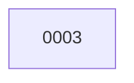

# Backlog

**3 changes** — 🟣 1 groomed · ✅ 2 done

## 🟣 Groomed (1)

| # | Title | Priority | Type | Spec | Readiness |
|---|-------|----------|------|------|-----------|
| [0003](active/0003-release-workflow-uses-built-in-github-token.md) | Release workflow uses built-in GitHub token | `high` | `chore` | [spec](../superpowers/specs/2026-10-26-release-workflow-uses-built-in-github-token-design.md) | build-ready |

✅ Archive — done (2)

| # | Title | Closed |
|---|-------|--------|
| [0002](archive/2026-10-26-0002-fix-version-bump-script-trailing-newline.md) | Fix version-bump script trailing newline | 2026-10-26 |
| [0001](archive/2026-10-26-0001-openai-realtime-tts-with-gpt-realtime-2-1-mini.md) | OpenAI Realtime TTS with gpt-realtime-2.1-mini | 2026-10-26 |

