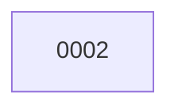

# Backlog

**2 changes** — 🟡 1 proposed · ✅ 1 done

## 🟡 Proposed (1)

| # | Title | Priority | Type | Readiness |
|---|-------|----------|------|-----------|
| [0002](active/0002-fix-version-bump-script-trailing-newline.md) | Fix version-bump script trailing newline | `high` | `fix` | needs-grooming |

✅ Archive — done (1)

| # | Title | Closed |
|---|-------|--------|
| [0001](archive/2026-10-26-0001-openai-realtime-tts-with-gpt-realtime-2-1-mini.md) | OpenAI Realtime TTS with gpt-realtime-2.1-mini | 2026-10-26 |

