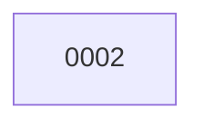

# Backlog

**2 changes** — 🟢 1 in progress · ✅ 1 done

## 🟢 In progress (1)

| # | Title | Priority | Type | Spec | Branch | State |
|---|-------|----------|------|------|--------|-------|
| [0002](active/0002-fix-version-bump-script-trailing-newline.md) | Fix version-bump script trailing newline | `high` | `fix` | [spec](../superpowers/specs/2026-10-26-fix-version-bump-script-trailing-newline-design.md) | `fix/fix-version-bump-script-trailing-newline` | building |

✅ Archive — done (1)

| # | Title | Closed |
|---|-------|--------|
| [0001](archive/2026-10-26-0001-openai-realtime-tts-with-gpt-realtime-2-1-mini.md) | OpenAI Realtime TTS with gpt-realtime-2.1-mini | 2026-10-26 |

